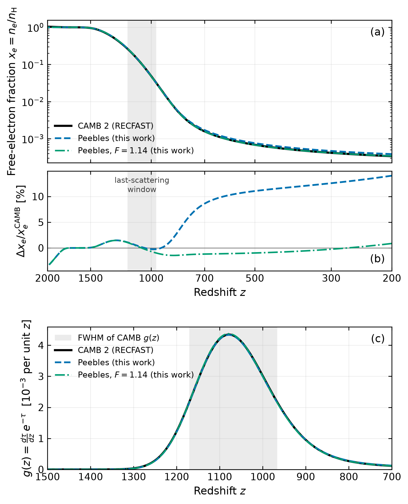
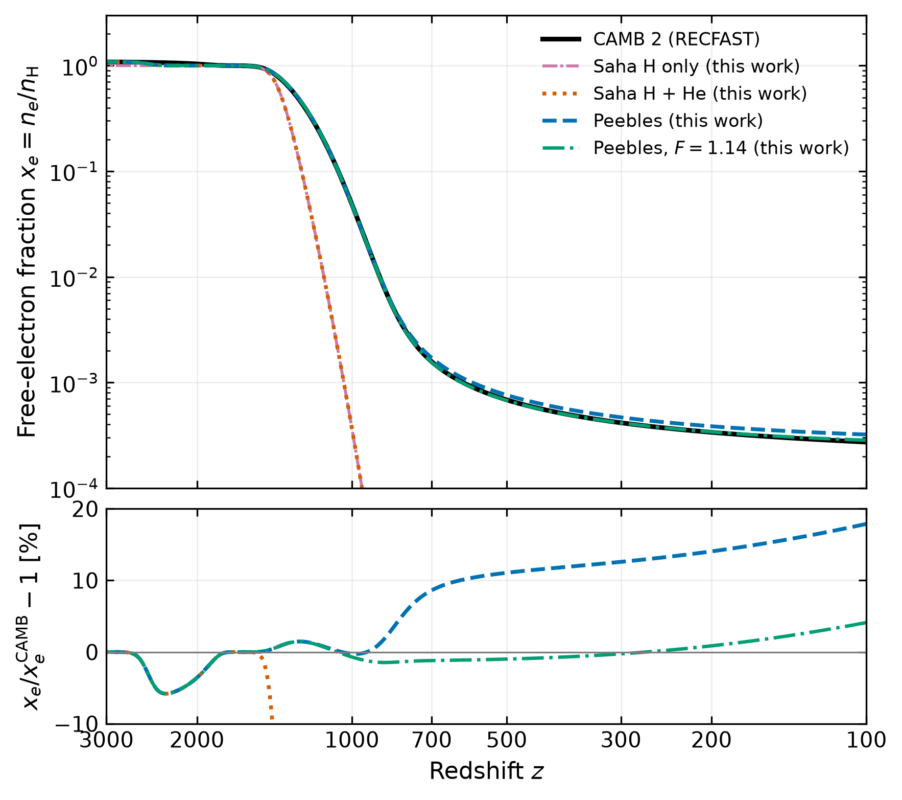

# CMB Decoupling

[](https://github.com/sethuastro/CMB_Decoupling/actions/workflows/tests.yml)
[](LICENSE)
[](https://doi.org/10.5281/zenodo.23932529)

When is the cosmic microwave background actually emitted, and how thick is the "surface" it comes
from? I built this code to learn recombination physics from first principles by following the
free-electron fraction $`x_e(z)`$ through hydrogen recombination. I started with Saha equilibrium,
which puts last scattering at $`z_\ast = 1291`$, far too early. I then implemented the Peebles
three-level atom, and from its $`x_e(z)`$ I computed the Thomson optical depth $\tau(z)$ and the
visibility function $`g(z)`$. I validated every step against CAMB, which uses the RECFAST
recombination code, run on exactly the same Planck 2018 background. The plain Peebles model, with no
fudge factor, reproduces CAMB's last-scattering redshift to 0.45 and the width of last scattering to
0.67 in redshift. Its residual ionisation at $`z = 200`$ is 14.05% too high, and I explain why below.

## Key results

<p align="center">
  
</p>

*(a) Free-electron fraction from CAMB/RECFAST, my Peebles model and the Peebles model with the
RECFAST fudge factor $`F = 1.14`$. (b) Fractional residual relative to CAMB; the grey band is the
last-scattering window (the FWHM of CAMB's $`g(z)`$). (c) The visibility function.*

Planck 2018 background, no reionisation. CAMB 2.0.5 is run with the same parameters (massless
neutrinos, same $`Y_p`$ and $`T_0`$), so the differences come from the recombination physics alone.
Nothing has been tuned to match CAMB.

| | Peebles (this work) | Peebles, $`F = 1.14`$ (this work) | CAMB 2.0.5 (RECFAST) |
|---|---|---|---|
| $`z_\ast`$, where $\tau = 1$ | 1089.44 | 1090.28 | 1089.89 |
| Peak of $`g(z)`$ per unit redshift | 1078.80 | 1079.05 | 1078.37 |
| Peak of visibility per unit conformal time | 1089.11 | 1089.32 | 1088.78 |
| Width of last scattering (FWHM of $`g`$) | 203.33 | 202.73 | 204.00 |
| $`z_{\rm dec}`$, where $`\Gamma_T = H`$ | 903.18 | 904.44 | 903.55 |
| $`x_e(z = 200)`$ | 3.849 × 10⁻⁴ | 3.404 × 10⁻⁴ | 3.375 × 10⁻⁴ |
| $`x_e(z = 0)`$ | 2.665 × 10⁻⁴ | 2.351 × 10⁻⁴ | 1.738 × 10⁻⁴ |

**How far $`x_e`$ is from CAMB.** Fractional residual $`\Delta x_e/x_e = x_e/x_e^{\rm CAMB} - 1`$
on $`z = 200\text{–}2000`$, sampled every $\Delta z = 0.1$:

| | Peebles (this work) | Peebles, $`F = 1.14`$ (this work) |
|---|---|---|
| (a) Largest $`\lvert\Delta x_e/x_e\rvert`$ in the last-scattering window, $`z = 966.5\text{–}1170.5`$ | 1.08% (at $`z = 1170.5`$) | 1.04% (at $`z = 1170.5`$) |
| (b) Most negative residual | −3.58% (at $`z = 2000`$) | −3.58% (at $`z = 2000`$) |
| (c) Most positive residual | +14.05% (at $`z = 200`$) | +1.46% (at $`z = 1264`$) |
| Range over the hydrogen-only era, $`z = 200\text{–}1800`$ | −0.33% to +14.05% | −1.46% to +1.46% |

**(a) Last scattering.** This is the part that matters for the CMB. Across the window that holds half
the visibility, my $`x_e`$ is within 1.08% of CAMB's. That is why $`z_\ast`$ and the width agree to
better than one unit of redshift. The largest value sits at the window's upper edge, because just
above the window both curves in panel (b) rise to a bump, which reaches +1.46% at $`z = 1264`$ for
the $`F = 1.14`$ run.
CAMB's RECFAST has two corrections that my model lacks: its own fudge factor $`F = 1.125`$, and two
Gaussian corrections to the recombination rate centred at $`z \approx 1452`$ and 867 (the
`RECFAST_Hswitch` option, fitted to multi-level calculations). I think these are the likely origin of
the bump, but I have not isolated it.

**(b) Helium.** Above $`z = 1800`$ I treat helium in Saha equilibrium, while RECFAST evolves helium
recombination with a rate equation. Real helium recombination lags Saha, so my $`x_e`$ is too low.
The −3.58% minimum on this range sits at its upper edge, $`z = 2000`$. Beyond that range the gap
reaches −5.81% at $`z = 2299`$. Helium has recombined well before last scattering, so this does not
affect $`z_\ast`$.

**(c) Late times.** Below the last-scattering window the plain Peebles residual grows steadily,
reaching +14.05% at $`z = 200`$. The largest value over the whole range therefore sits at
the lower end of the range I chose. There, $`C_r \to 1`$ and the freeze-out value of $`x_e`$ is set by
the recombination rate $`\alpha_B`$. A three-level atom with the case-B rate recombines too slowly
compared with a full multi-level atom. Seager, Sasselov & Scott (1999) introduced the fudge factor
$`F = 1.14`$ on $`\alpha_B`$ to correct for exactly this. With $`F = 1.14`$, my residual stays within
±1.46% over the whole hydrogen era, and the excess at $`z = 200`$ drops from +14.05% to +0.87%. So the
late-time excess is the three-level approximation, not a numerical error.

The comparison is not fully independent, because CAMB's RECFAST is itself a fudged three-level model.
The fudge also moves $`z_\ast`$ slightly *away* from CAMB, from 1089.44 to 1090.28, which is why I
keep the plain Peebles model as my headline result. The small positive residual that remains at the lowest
redshifts with $`F = 1.14`$ (+0.87% at $`z = 200`$) is what I would expect from my second simplification. I keep the
gas at the radiation temperature, while RECFAST lets it cool faster, and cooler gas recombines faster.
By $`z = 0`$ this matters a lot: even with $`F = 1.14`$, my $`x_e(0)`$ is 2.351 × 10⁻⁴ against CAMB's
1.738 × 10⁻⁴.

**Two more checks.**
- I fed CAMB's own $`x_e(z)`$ into my optical-depth integrator. It gives $`z_\ast = 1089.8901`$,
  against CAMB's internal 1089.8923, so the integrator is not hiding anything.
- The familiar "$`z \approx 1090`$" is $`z_\ast`$ or the peak per unit conformal time. The peak of
  $`g(z)`$ per unit *redshift* is about 10 lower, at 1078.80.
  [`docs/theory.md`](docs/theory.md#63-which-redshift-of-last-scattering) explains why.

Every number above is printed by `python scripts/validate.py` (written to `results/validation.md`) or
`python scripts/make_figures.py` (written to `results/key_results.md`).

## Physics

The full derivations, with each approximation stated where it is made, are in
[`docs/theory.md`](docs/theory.md). These are the equations the code solves.

**Background.** Flat ΛCDM with $`H(z) = H_0\sqrt{\Omega_m(1+z)^3 + \Omega_r(1+z)^4 + \Omega_\Lambda}`$,
radiation temperature $`T = T_0(1+z)`$ and hydrogen density $`n_{\rm H} = (1 - Y_p)\,\rho_b/m_{\rm H}`$.
Here $`Y_p`$ is the helium mass fraction, $`\rho_b`$ the baryon density and $`m_{\rm H}`$ the hydrogen
atom mass. The parameters are Planck 2018 VI, Table 2 (TT,TE,EE+lowE+lensing).

### Saha equilibrium, with helium

If ionisation and recombination are in balance, the ionised fraction $`x_e = n_e/n_{\rm H}`$ of pure
hydrogen obeys

```math
\frac{x_e^2}{1 - x_e} = \frac{1}{n_{\rm H}}\left(\frac{m_e k_B T}{2\pi\hbar^2}\right)^{3/2} e^{-E_{\rm ion}/k_BT},
```

where $`m_e`$ is the electron mass, $`k_B`$ Boltzmann's constant, $`\hbar`$ the reduced Planck constant
and $`E_{\rm ion} = 13.598`$ eV the hydrogen ionisation energy. Helium adds two more equilibria:

```math
\frac{n_{\rm He\,II}\, n_e}{n_{\rm He\,I}} = 4\left(\frac{m_ek_BT}{2\pi\hbar^2}\right)^{3/2} e^{-\chi_{\rm He\,I}/k_BT},
\qquad
\frac{n_{\rm He\,III}\, n_e}{n_{\rm He\,II}} = \left(\frac{m_ek_BT}{2\pi\hbar^2}\right)^{3/2} e^{-\chi_{\rm He\,II}/k_BT}.
```

Here $`\chi_{\rm He\,I} = 24.587`$ eV and $`\chi_{\rm He\,II} = 54.418`$ eV are the helium ionisation
energies, and 4 and 1 are statistical-weight factors. These are closed by charge neutrality:

```math
x_e = x_{\rm H\,II} + f_{\rm He}\,(y_{\rm He\,II} + 2y_{\rm He\,III}),
```

with $`x_{\rm H\,II} = n_p/n_{\rm H}`$, $`y_i = n_i/n_{\rm He}`$ and $`f_{\rm He} = n_{\rm He}/n_{\rm H}`$.
Saha fails during recombination for two reasons:
- A direct capture to the ground state emits a photon that immediately ionises a neighbouring atom.
- Lyman-α photons are trapped by resonant scattering.

### The Peebles three-level atom

Below $`z = 1800`$ the code integrates the Peebles (1968) equation. It treats hydrogen as a ground
state, an $n = 2$ level and the continuum:

```math
\frac{dx_e}{dz} = \frac{C_r}{(1+z)H(z)}\left[\alpha_B\, n_{\rm H}\, x_e^2 - \beta_B\,(1 - x_e)\, e^{-E_{{\rm Ly}\alpha}/k_BT}\right],
\qquad
C_r = \frac{\Lambda_{2s1s} + \Lambda_\alpha}{\Lambda_{2s1s} + \Lambda_\alpha + \beta_B}.
```

- $`\alpha_B(T)`$ is the case-B recombination coefficient: recombinations to $n \ge 2$ only (Péquignot,
  Petitjean & Boisson 1991 fit, multiplied by a fudge factor $F$, which is 1 by default).
- $`\beta_B = \alpha_B\,(m_ek_BT/2\pi\hbar^2)^{3/2}\,e^{-E_{\rm ion}/4k_BT}`$ is the photo-ionisation rate
  from $n = 2$, fixed by detailed balance.
- $`E_{{\rm Ly}\alpha} = \tfrac34 E_{\rm ion}`$ is the Lyman-α energy.
- $`\Lambda_{2s1s} = 8.22458\ {\rm s^{-1}}`$ is the two-photon 2s → 1s decay rate.
- $`\Lambda_\alpha = 8\pi H/(\lambda_\alpha^3\, n_{1s})`$ is the rate at which Lyman-α photons redshift
  out of the line, with $`\lambda_\alpha`$ the Lyman-α wavelength and
  $`n_{1s} = (1 - x_e)\,n_{\rm H}`$ the ground-state density.

$`C_r`$ is the probability that an atom in $n = 2$ reaches the ground state before being
re-ionised. During recombination $`C_r \ll 1`$, and recombination is throttled by the two slow
escape routes. The bracket vanishes exactly at the Saha solution, so the ODE starts from Saha at
$`z = 1800`$. It is stiff, so it is integrated with the implicit Radau method.

### Thomson optical depth

Photons scatter off free electrons at the rate $`\Gamma_T = n_e\sigma_T c`$, where $`\sigma_T`$ is the
Thomson cross-section and $c$ the speed of light. The optical depth back to redshift $z$ is

```math
\tau(z) = \int_0^z \frac{n_e(z')\,\sigma_T\, c}{(1+z')\,H(z')}\,dz', \qquad n_e = x_e\, n_{\rm H}.
```

I define the last-scattering redshift $`z_\ast`$ by $`\tau(z_\ast) = 1`$, as Planck does.

### Visibility function

$`e^{-\tau(z)}`$ is the probability that a photon seen today has not scattered since $z$. So the
probability density that it last scattered at $z$ is

```math
g(z) = \frac{d\tau}{dz}\,e^{-\tau(z)}, \qquad \int_0^{z} g\,dz' = 1 - e^{-\tau(z)} \to 1 .
```

Its full width at half maximum is the thickness of the last-scattering surface.

<p align="center">
  
</p>

*Saha equilibrium (orange, pink) recombines far too early. The Peebles model sits almost on top of
CAMB through last scattering. More figures: [`figures/visibility_function.png`](figures/visibility_function.png)
(also shows $`\tau(z)`$) and [`figures/rates.png`](figures/rates.png) ($`\Gamma_T/H`$ and $`C_r`$).*

## Approximations and limitations

| Approximation | What it does to the result | What would fix it |
|---|---|---|
| Three-level atom with case-B $`\alpha_B`$, no fudge factor | $`x_e`$ too high after recombination: +14.05% at $`z = 200`$ (+0.87% with $F = 1.14$) | multi-level atom (HyRec, CosmoRec) |
| Gas temperature equals radiation temperature | $`x_e`$ too high at late times; $`x_e(0)`$ is 2.351 × 10⁻⁴ vs 1.738 × 10⁻⁴ even with $F = 1.14$ | evolve the matter temperature with Compton heating |
| Helium in Saha equilibrium; neutral below $`z = 1800`$ | $`x_e`$ too low in the helium era: −5.81% at $`z = 2299`$ | helium rate equations (as in RECFAST) |
| No Lyman-series feedback, Raman scattering or two-photon corrections; none of RECFAST's extra rate corrections | ~1% wiggles in $`x_e`$ around last scattering (e.g. +1.46% at $`z = 1264`$ with $F = 1.14$) | HyRec / CosmoRec |
| No reionisation | $\tau$ is the optical depth to recombination only; reionisation adds a further optical depth at low redshift | add a reionisation model |
| Massless neutrinos | none in the comparison (CAMB uses the same) | massive-neutrino background |

CAMB's RECFAST includes helium rate equations, matter-temperature evolution, $`F = 1.125`$ and further
corrections. HyRec and CosmoRec are not in the pip-installed CAMB, so I could not compare with them.
The code is a learning tool and a check of the physics. It is not a replacement for those codes in
parameter estimation.

## Installation and quick start

You'll need Python 3.10 or newer. With pip:

```bash
git clone https://github.com/sethuastro/CMB_Decoupling.git
cd CMB_Decoupling
python -m venv .venv
source .venv/bin/activate          # on Windows: .venv\Scripts\activate
pip install -e ".[dev]"            # or, for the exact versions I used: pip install -r requirements.txt && pip install -e . --no-deps
```

With conda:

```bash
conda create -n cmb python=3.13 && conda activate cmb
pip install -e ".[dev]"
```

Reproduce the validation figure and tables (well under a minute):

```bash
python scripts/validate.py         # figures/validation.{png,pdf}, results/validation.{md,json}
python scripts/make_figures.py     # the other figures, results/key_results.{md,json}
```

Or, from Python:

```python
from cmb_decoupling import PLANCK2018, solve_peebles, last_scattering

history = solve_peebles(PLANCK2018)                 # Peebles x_e(z) on the Planck 2018 background
ls = last_scattering(history.x_e, PLANCK2018)       # tau(z) and g(z)
print(f"{ls.z_tau_one():.2f}  {ls.fwhm()[0]:.2f}")  # 1089.44  203.33
```

**How it's organised**

```
src/cmb_decoupling/   the package
  cosmology.py        Planck 2018 parameters (defined once), H(z), n_H(z)
  constants.py        physical and atomic constants, with sources
  saha.py             Saha equilibrium for hydrogen and helium
  peebles.py          Peebles three-level atom (stiff ODE)
  visibility.py       Thomson rate, tau(z), g(z), peak and width
  results.py          summary numbers and residuals against a reference
  reference.py        the CAMB comparison run
scripts/              validate.py (comparison with CAMB), make_figures.py (all other figures)
tests/                pytest suite
notebooks/            a walk-through from Saha to last scattering
docs/theory.md        the derivations, step by step, with references
archive/              my original scripts, kept as they were
```

## Tests and CI

```bash
pytest
```

There are 41 tests. Some check things that physics says must be true:
- $`x_e \to 1`$ at high redshift in Saha;
- the Peebles rate vanishes exactly at the Saha solution (detailed balance);
- charge is conserved in the hydrogen–helium Saha solution;
- $`\int g\,dz = 1 - e^{-\tau}`$ exactly, and $`\int g\,dz = 1`$ to $10^{-6}$ since $`\tau(3000) \gg 1`$.

Others check that the answers don't change when I tighten the ODE tolerances, refine the redshift
grid or move the Saha-to-Peebles switch.

The comparison tests against CAMB use tolerances that describe the agreement I measured, not targets
I tuned the model to meet:
- $`z_\ast`$, the peak and $`z_{\rm dec}`$ within 2;
- the FWHM within 3;
- $`\lvert\Delta x_e/x_e\rvert < 2\%`$ in the last-scattering window.

GitHub Actions runs on every push (badge at the top):
- lint (ruff);
- tests on Linux (Python 3.11 and 3.13) and on Windows;
- both scripts, rebuilt from scratch;
- a check that the committed results tables match the code;
- the notebook, run top to bottom.

## Roadmap

These are **planned, not done**:

1. **Sound horizon $`r_s(z_\ast)`$**: the comoving distance a sound wave in the photon–baryon fluid
   travels before last scattering. This sets the angular scale of the acoustic peaks.
2. **Angular power spectrum $`C_\ell`$**: starting from the visibility function computed here.

## Citation and licence

If you use this code, please cite it with the metadata in [`CITATION.cff`](CITATION.cff); GitHub's
"Cite this repository" button generates BibTeX from it. The code is released under the
[MIT licence](LICENSE).

**References:**
- Peebles 1968, *ApJ* **153**, 1
- Zel'dovich, Kurt & Sunyaev 1968, *Zh. Eksp. Teor. Fiz.* **55**, 278
- Seager, Sasselov & Scott 1999, *ApJ* **523**, L1
- Seager, Sasselov & Scott 2000, *ApJS* **128**, 407
- Péquignot, Petitjean & Boisson 1991, *A&A* **251**, 680
- Planck Collaboration 2020, *A&A* **641**, A6
- Lewis, Challinor & Lasenby 2000, *ApJ* **538**, 473 (CAMB)
- Dodelson & Schmidt 2020, *Modern Cosmology*, 2nd ed.

The full list is in [`docs/theory.md`](docs/theory.md#9-references).

**About me.** I'm Sethulekshmi Beena, MSc Astrophysics (Distinction), University of Hertfordshire.
ORCID [0009-0004-4767-2733](https://orcid.org/0009-0004-4767-2733) ·
[homepage](https://sethuastro.github.io/)
