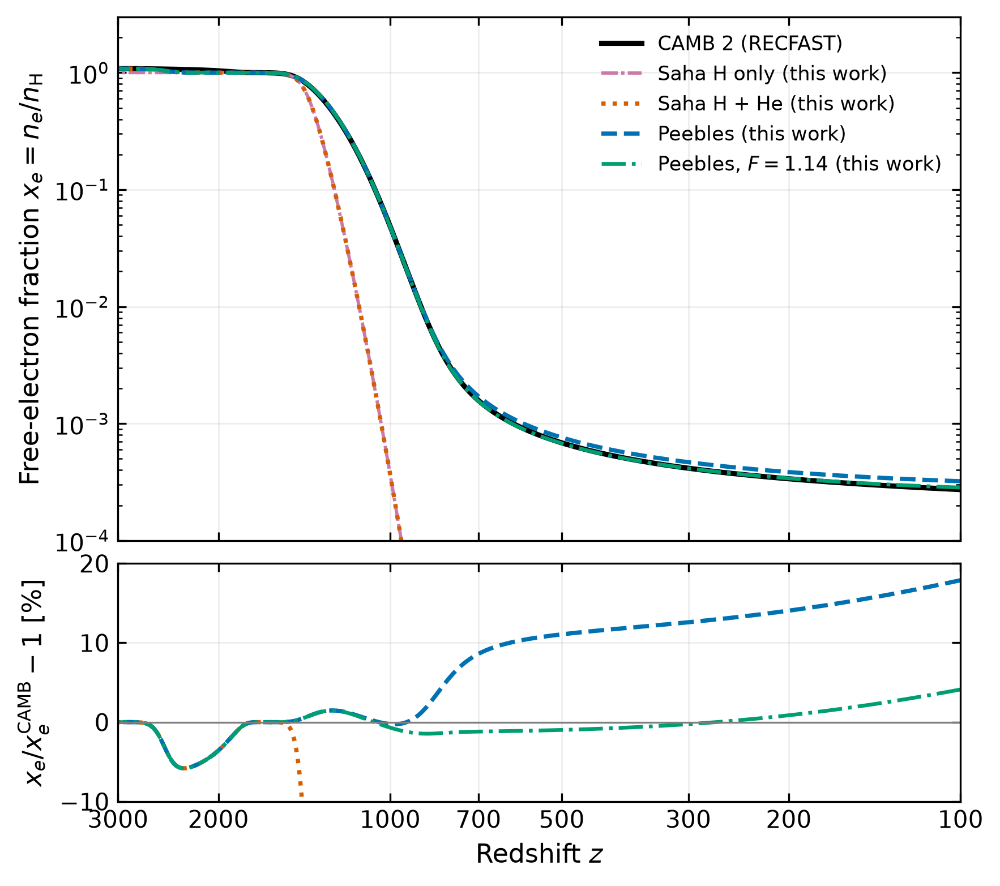
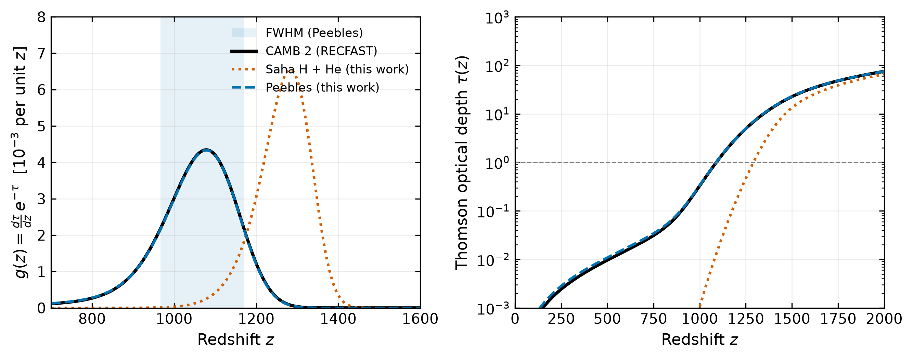

# CMB Decoupling: hydrogen recombination and the last-scattering surface

[](https://github.com/sethuastro/CMB_Decoupling_Project_/actions/workflows/tests.yml)
[](LICENSE)

About 370 000 years after the Big Bang, the Universe cooled enough for electrons and protons to
combine into neutral hydrogen. The photons that had been trapped by Thomson scattering streamed
free, and we observe them today as the cosmic microwave background (CMB). This repository models
that transition from first principles. It starts from **Saha equilibrium** and shows why
equilibrium fails. It then solves the **Peebles three-level-atom** equation, which includes
Lyman-α escape, two-photon 2s→1s decay and the suppression factor $C_r$. From the resulting
ionisation history $x_e(z)$ it computes the **Thomson scattering rate**, the **optical depth**
$\tau(z)$ and the **visibility function** $g(z)$, whose shape defines the redshift and thickness of the
last-scattering surface. All results use Planck 2018 parameters and are validated against
**CAMB** (RECFAST recombination), with the residuals reported and explained.

<p align="center">
  
</p>
<p align="center">
  
</p>

*Top: free-electron fraction $x_e = n_e/n_{\rm H}$ (upper panel) and residuals relative to CAMB/RECFAST
(lower panel). Bottom: visibility function $g(z)$ with its FWHM shaded (left) and Thomson optical depth (right).
Saha equilibrium predicts last scattering at $z \approx 1280$; the Peebles model and CAMB agree near $z \approx 1080$–$1090$.*

## Key results

Planck 2018 cosmology, no reionisation. "This work" is the pure Peebles model ($F = 1$).
The CAMB reference uses the same background (Section 8 of the [theory notes](docs/theory.md)).

| Quantity | This work | CAMB 2.0.5 (RECFAST) | Difference |
|---|---|---|---|
| Last-scattering redshift $z_*$, where $\tau = 1$ | **1089.44** | 1089.89 | −0.45 |
| Peak of $g(z)$ (per unit redshift) | 1078.80 | 1078.37 | +0.43 |
| Peak of visibility (per unit conformal time) | 1089.11 | 1088.78 | +0.32 |
| Width of last-scattering surface, FWHM of $g(z)$ | $\Delta z$ = 203.3 | 204.0 | −0.7 |
| Decoupling redshift $z_{\rm dec}$, where $\Gamma_T = H$ | 903.2 | 903.6 | −0.4 |
| Freeze-out residual ionisation $x_e(z = 200)$ | 3.85 × 10⁻⁴ | 3.38 × 10⁻⁴ | +14% |
| Residual ionisation $x_e(z = 0)$, no reionisation | 2.67 × 10⁻⁴ | 1.74 × 10⁻⁴ | +53% |

For comparison, Saha equilibrium alone gives $z_* = 1291$ and a visibility peak at $z = 1284$.
Each step of the calculation is cross-checked independently. One example: feeding CAMB's own $x_e(z)$
through this code's optical-depth integrator recovers CAMB's internal $z_* = 1089.892$ to within 0.01.
The full table, including the literature fudge-factor variant ($F = 1.14$, Seager et al. 1999), is in
[`results/key_results.md`](results/key_results.md).

**Where and why the model differs from CAMB.**
- The last-scattering quantities agree to better than 1 in redshift, because the Peebles model tracks
  RECFAST to within about 2% over $1000 \lesssim z \lesssim 1500$, the epoch that sets $\tau$.
- At $z \lesssim 900$ the three-level atom over-predicts the residual ionisation by 10–18%. This is the known
  deficiency that RECFAST corrects with a multi-level-atom fudge factor.
- Below $z \sim 300$ the excess grows further, because this model assumes the matter temperature
  equals the radiation temperature.
- At $z \approx 1800$–2800, $x_e$ is up to 6% low, because helium is treated in Saha equilibrium while
  real He I recombination is delayed.

## Repository layout

```
src/cmb_decoupling/   importable package
  cosmology.py        Planck 2018 parameters (single source), H(z), n_H(z)
  constants.py        physical and atomic constants (astropy / CODATA 2018, cited atomic data)
  saha.py             Saha equilibrium for H and He I/II/III
  peebles.py          Peebles three-level atom (stiff ODE, Radau)
  visibility.py       Thomson rate, optical depth tau(z), visibility g(z), peak and width
  results.py          key derived quantities, computed in one place
  reference.py        CAMB/RECFAST reference run with a matched background
  plotting.py         colour-blind-safe figure style (PDF + PNG)
notebooks/            narrative walk-through: Saha -> Peebles -> last scattering
scripts/              make_figures.py regenerates every figure and the results table
tests/                pytest: limiting cases, conservation laws, convergence, regression vs CAMB
docs/theory.md        step-by-step derivations with references
figures/  results/    generated outputs
archive/              original scripts, kept unmodified
```

## Quickstart

Requires Python ≥ 3.10.

```bash
git clone https://github.com/sethuastro/CMB_Decoupling_Project_.git
cd CMB_Decoupling_Project_
python -m venv .venv
source .venv/bin/activate          # Windows: .venv\Scripts\activate
pip install -e ".[dev]"            # or: pip install -r requirements.txt && pip install -e .

pytest                             # 38 tests: physics limits, convergence, CAMB regression
python scripts/make_figures.py     # regenerates figures/ and results/
jupyter lab notebooks/recombination_and_decoupling.ipynb
```

Minimal use:

```python
from cmb_decoupling import PLANCK2018, solve_peebles, last_scattering

history = solve_peebles(PLANCK2018)
ls = last_scattering(history.x_e, PLANCK2018)
print(ls.z_tau_one(), ls.z_peak(), ls.fwhm()[0])   # 1089.44  1078.80  203.33
```

## Validation and testing

- **Limiting cases:**
  - $x_e \to 1$ at high $z$, and $x_e \to 1 + 2f_{\rm He}$ when helium is fully ionised.
  - $C_r \to 1$ at late times.
  - The Peebles rate vanishes exactly at the Saha solution (detailed balance).
- **Conservation:** charge neutrality in the coupled H + He Saha solution; $\int g\,dz = 1 - e^{-\tau_{\max}}$.
- **Numerical convergence:** ODE tolerances, the redshift at which the ODE takes over from Saha,
  the integration grid, and the optical-depth integrator compared with adaptive quadrature.
- **Reference comparison:** $H(z)$ matches CAMB to $10^{-6}$; last-scattering quantities match within the
  tolerances in `tests/test_regression.py`, which record the *measured* agreement and are not tuned.
- **Continuous integration** runs linting (ruff), the test suite, figure regeneration and the notebook
  on every push.

## Limitations and future work

- **Multi-level hydrogen atom.** The three-level atom over-predicts late-time $x_e$ by 10–18%. Next steps
  are the RECFAST fudge-factor approach as a documented option, or interfacing with HyRec
  (Ali-Haïmoud & Hirata 2011) or CosmoRec (Chluba & Thomas 2011).
- **Helium recombination.** Helium is currently in Saha equilibrium. The next step is a He I recombination
  ODE with its own escape probabilities (Seager et al. 2000; Switzer & Hirata 2008).
- **Matter temperature.** Evolve $T_{\rm m}$ with Compton heating and adiabatic cooling instead of
  assuming $T_{\rm m} = T_\gamma$.
- **Reionisation.** Add a tanh reionisation model so that $\tau$ includes the late-time contribution
  ($\tau_{\rm reion} \approx 0.054$, Planck 2018).
- **Parameter sensitivity.** Map how $z_*$ and the width of last scattering respond to $\Omega_b h^2$,
  $\Omega_m h^2$ and $Y_p$.

## References

- Peebles, P. J. E. 1968, *ApJ* **153**, 1
- Zel'dovich, Ya. B., Kurt, V. G. & Sunyaev, R. A. 1968, *Zh. Eksp. Teor. Fiz.* **55**, 278
- Seager, S., Sasselov, D. D. & Scott, D. 1999, *ApJ* **523**, L1
- Seager, S., Sasselov, D. D. & Scott, D. 2000, *ApJS* **128**, 407
- Planck Collaboration 2020, *A&A* **641**, A6 (Planck 2018 results VI)
- Lewis, A., Challinor, A. & Lasenby, A. 2000, *ApJ* **538**, 473 (CAMB)
- Dodelson, S. & Schmidt, F. 2020, *Modern Cosmology*, 2nd ed., Academic Press
- Péquignot, D., Petitjean, P. & Boisson, C. 1991, *A&A* **251**, 680
- Fixsen, D. J. 2009, *ApJ* **707**, 916

The complete list, with what each reference is used for, is in [`docs/theory.md`](docs/theory.md#9-references).

## Author

**Sethulekshmi**, MSc Astrophysics, University of Hertfordshire
ORCID: [0009-0004-4767-2733](https://orcid.org/0009-0004-4767-2733) ·
Homepage: [sethulekshmibeena.github.io/my-webpage](https://sethulekshmibeena.github.io/my-webpage/)

If you use this code, please cite it using [`CITATION.cff`](CITATION.cff). Released under the [MIT licence](LICENSE).
